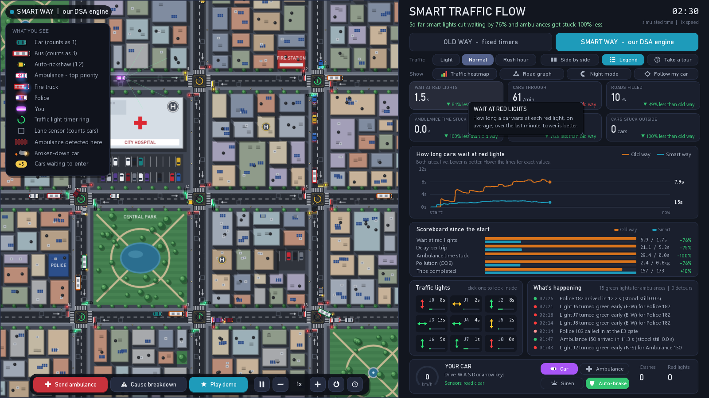
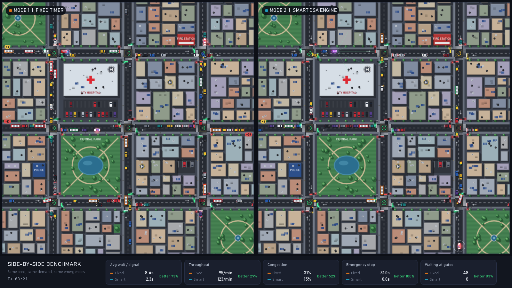
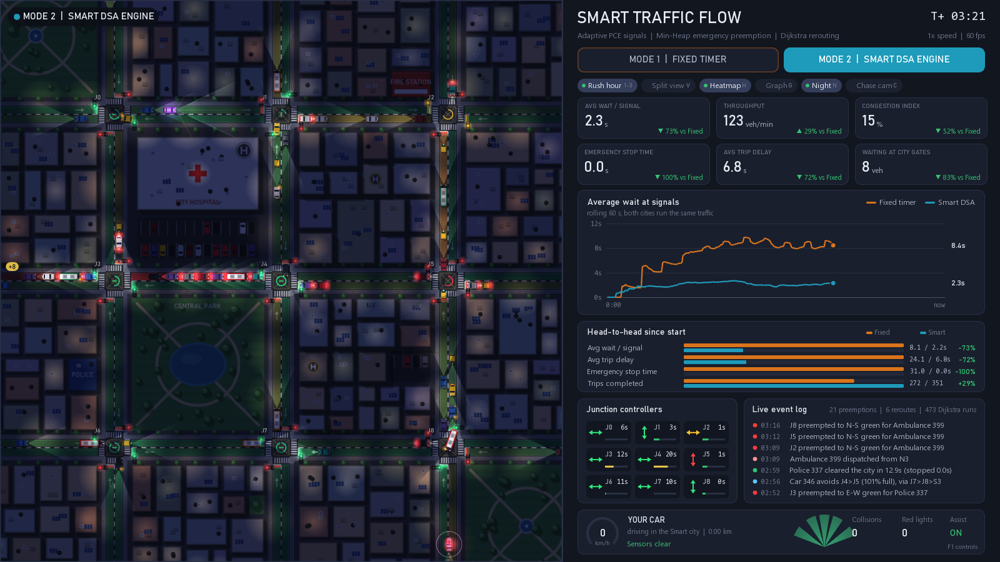
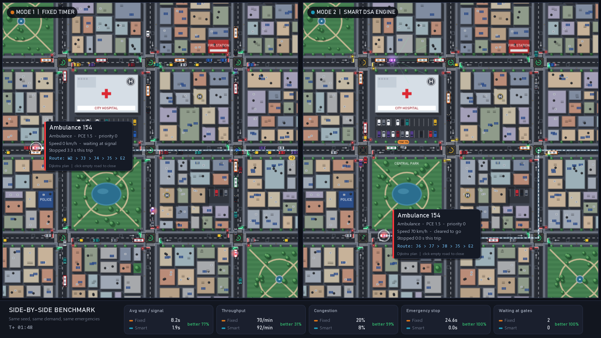
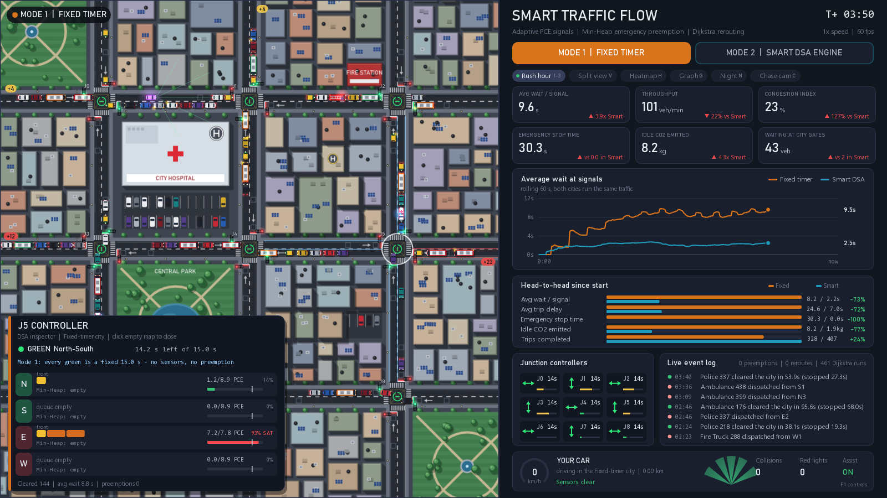
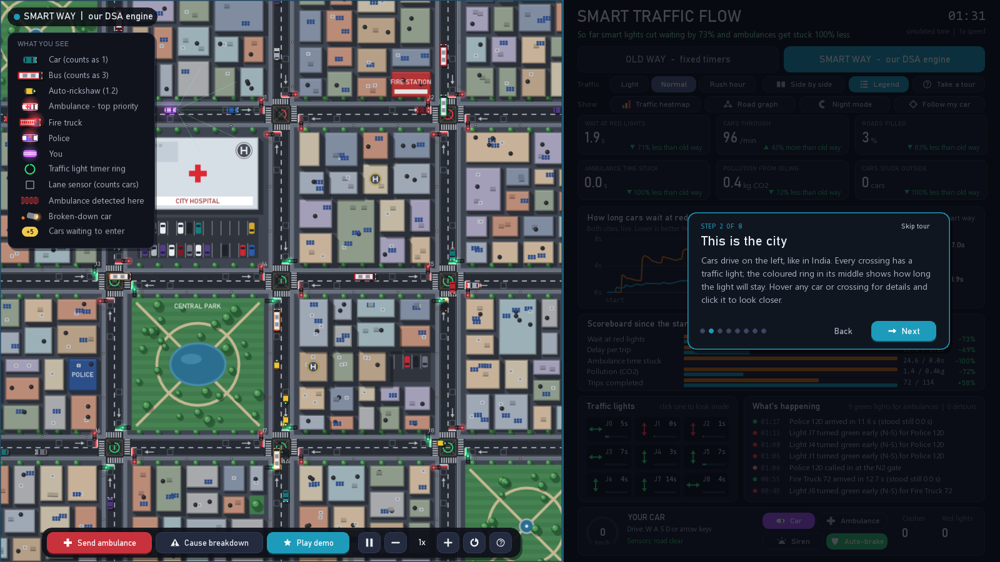

# Smart Traffic Flow

**Smart Traffic Flow Optimization & Emergency Preemption Simulation Engine in C++**
Team FlowOptimizers (DSCPP-321-III), DSA (CS201) Project-Based Learning, Graphic Era (Deemed to be University)

An interactive top-down 2D traffic game built with C++17 and SFML 2.6. Two identical cities run side by side
on the same random seed:

| | Mode 1: Fixed timer | Mode 2: Smart DSA engine |
|---|---|---|
| Signals | fixed 15 s green | green split proportional to queue PCE, gap-out and extension |
| Emergency vehicles | stuck in the FIFO queue | Min-Heap preemption and a corridor where traffic pulls over |
| Routing | static shortest path | Dijkstra rerouting when the next road is at least 80 % full |

Because both cities get exactly the same traffic, every number on the dashboard is a fair comparison.



| Side-by-side benchmark (`V`) | Night + congestion heatmap (`N`, `H`) |
|---|---|
|  |  |

| Showcase `F2`: same ambulance, same breakdown | DSA inspector (click a junction) |
|---|---|
|  |  |

## Results (5 seeds x 10 simulated minutes, mean ± std)

`SmartTrafficFlow --bench 600 --seeds 5 --demand 2 --csv docs/results/rush`

| Metric (rush hour) | Fixed | Smart | Better |
|---|---:|---:|---:|
| Average wait per signal | 8.35 ± 0.26 s | 2.19 ± 0.12 s | **74 %** |
| Average trip delay | 25.8 ± 1.0 s | 7.1 ± 0.4 s | **73 %** |
| Emergency vehicle stopped time | 32.0 ± 3.0 s | 0.53 ± 0.29 s | **98 %** |
| Idle CO2 emitted | 32.2 ± 5.3 kg | 4.5 ± 0.3 kg | **86 %** |
| Trips completed | 932 ± 24 | 1073 ± 21 | +15 % |
| Vehicles stuck at city gates | 113 ± 34 | 0.4 ± 0.6 | 99.6 % |

At normal demand: wait −78 %, emergency stop −99 %, CO2 −82 %. Raw data, ready to plot for the report:
`docs/results/{normal,rush}_{summary,timeseries}.csv`.
How every Phase-I claim is met is in [docs/PHASE1_COMPLIANCE.md](docs/PHASE1_COMPLIANCE.md).

## Build and run

### Windows (one click)

```bat
build.bat
```

This configures with CMake, builds, runs the unit tests, and starts the game. It uses the portable toolchain in
`tools/` (GCC 13.1 + CMake 3.30 + SFML 2.6.1) when it is there, otherwise your own `g++`, `cmake` and SFML.
The `tools/` folder is about 1 GB and is ignored by git. To recreate it, download these three into `tools/` and unzip:

- WinLibs GCC 13.1.0 64-bit (posix-seh, msvcrt): `winlibs-x86_64-posix-seh-gcc-13.1.0-mingw-w64msvcrt-11.0.0-r5.zip`
- SFML 2.6.1 for GCC 13.1.0 MinGW 64-bit: `SFML-2.6.1-windows-gcc-13.1.0-mingw-64-bit.zip`
- CMake 3.30 for Windows x64: `cmake-3.30.5-windows-x86_64.zip`

> The SFML build must match the compiler exactly (GCC 13.1.0, 64-bit). An older MinGW such as GCC 6.3 will not work.

### Any platform with CMake

```bash
cmake -S . -B build -DCMAKE_BUILD_TYPE=Release   # add -DSFML_DIR=<SFML>/lib/cmake/SFML if needed
cmake --build build -j 8
ctest --test-dir build --output-on-failure
cd build && ./SmartTrafficFlow
```

On Linux: `sudo apt install libsfml-dev`. On macOS: `brew install sfml@2`.
If SFML is missing, CMake still builds the engine and the tests.

### Command-line modes

| Command | What it does |
|---|---|
| `SmartTrafficFlow` | play |
| `SmartTrafficFlow --bench 600 --seeds 5 --demand 2 --csv out` | headless benchmark over 5 seeds, mean ± std, CSV files |
| `SmartTrafficFlow --grid 4 4 --seed 7` | play on a 4×4 city (2×2 … 4×4) with another random seed |
| `SmartTrafficFlow --screenshot out.png --warmup 120 --split --night` | renders one frame to a PNG and exits (`--showcase`, `--inspect J`, `--incident` also work) |

## Using it (no manual needed)

Everything on screen is clickable, and hovering anything shows a plain-English explanation.

- **Title screen:** *Start exploring*, *Take the 1-min tour* (an 8-step guided walkthrough with a spotlight), or *Watch the demo*.
- **Toolbar on the map:** *Send ambulance*, *Cause breakdown*, *Play demo*, pause, speed −/+, restart, help.
- **Right panel:** choose *Old way* or *Smart way*, the traffic level, *Side by side*, *Legend*, heatmap, road graph,
  night mode and follow-my-car. Car / Ambulance / Siren / Auto-brake buttons are in the *Your car* panel.
- **Map:** hover a car or crossing to see what it is; click a car to see its route; click a crossing (or a tile under
  *Traffic lights*) to open the inspector, which shows the queue and the emergency heap inside it.
- **Legend:** the *What you see* box explains every vehicle and symbol on the map.



## Keyboard shortcuts

| Key | Action | Key | Action |
|---|---|---|---|
| `W A S D` / arrows | drive | `M` | switch Fixed / Smart city |
| `Space` | handbrake (drift) | `V` | side-by-side benchmark |
| `T` | switch car / ambulance | `H` | congestion heatmap |
| `E` | siren (ambulance): preempts signals ahead | `G` | graph overlay with live Dijkstra weights |
| `B` | brake assist on / off | `N` | day / night |
| `C`, mouse wheel | chase camera, zoom | `X` | dispatch an ambulance (both cities) |
| click | inspect a vehicle and its Dijkstra route | `1` `2` `3` | light / normal / rush-hour demand |
| `[` `]` | simulation speed 0.5x to 8x | `P` / `Esc` | pause |
| `R` | restart both cities | `F1` / `F12` | help / screenshot |
| click a junction | **DSA inspector**: live FIFO queues, Min-Heap, saturation, green-split formula | `I` | road incident (breakdown) in both cities |
| `F2` | **viva showcase**: rush hour + breakdown + ambulance, side by side | `F5` | export the live metrics to CSV |

## Project structure and ownership

```
SmartTrafficFlow/
├── CMakeLists.txt, main.cpp          Yashvardhan Singh: build, execution loop, fixed 60 Hz sim tick, bench mode
├── include/ + src/
│   ├── Core/
│   │   ├── CityGrid          Yashvardhan: adjacency-list network, vehicle movement, spawning, metrics
│   │   ├── Pathfinder        Yashvardhan: Dijkstra with congestion weights, rerouting at >= 80 %
│   │   └── TrafficSignal     Yashvardhan: fixed vs PCE-adaptive green split, preemption phases
│   ├── Entities/
│   │   ├── Vehicle           Arsh Singh: abstract Vehicle -> PrivateCar, PublicBus, AutoRickshaw, EmergencyVehicle
│   │   ├── Lane              Arsh: FIFO std::queue + Min-Heap std::priority_queue
│   │   └── Intersection      Arsh: four approach lanes, heap-driven preemption, wait statistics
│   └── Graphics/
│       ├── Renderer          Sambhav Jaiswal: window, city art, vehicle sprites, signals, night lighting, overlays
│       ├── PlayerController  Sambhav: driving physics, 5 raycast sensors, brake assist, collisions
│       └── HUD               Sambhav: live dashboard, Fixed vs Smart chart, junction states, event log
├── tests/test_engine.cpp     91 unit + integration tests (no SFML needed)
└── docs/                     PHASE1_COMPLIANCE.md, benchmark CSVs in results/, screenshots/
```

The engine (Core + Entities) has no SFML dependency, so it can be unit-tested and benchmarked headless.

## How it works

**Each tick (1/60 s):**

1. Vehicles arrive at the 12 city gates (Poisson arrivals with rush-hour waves). Routes come from Dijkstra over
   the adjacency list (21 nodes, 48 directed roads).
2. Each `Intersection` checks the top of its four lanes' Min-Heaps (O(1) each). If an emergency vehicle is within
   230 px, the signal is preempted to that axis (with a short clearance), and `moveEmergencyToFront()` reorders the
   FIFO queue.
3. `TrafficSignal` runs Green, then Yellow (2 s), then All-Red (1 s). In Smart mode the next green is
   `clamp(min(5 + share x 20, 3 + 1.8 x PCE), 5, 25)` seconds, with gap-out when the green road empties.
4. The queue front is released when it is near the stop line, its axis is green, the cross traffic has left the
   box, and the next road has room ("don't block the box").
5. Every vehicle moves with the Intelligent Driver Model. Its forward sensor only looks at vehicles it can actually
   hit: the same lane, its junction box, and its exit road. Inside a box, the vehicle released first has right of
   way, so vehicles can never deadlock each other.
6. In Smart mode, when the next road on a vehicle's plan is at least 80 % saturated, Dijkstra re-plans from the
   upcoming junction with congestion weights `length x (1 + 2 x load_ratio^2)`. U-turns are forbidden.
7. Cars pull over to the kerb when an emergency vehicle is behind them, and the emergency vehicle drives the centre
   line past the queue.
8. Road incidents: a breakdown blocks a lane for 60 s. In Smart mode, the induction-loop sensors report the lane as
   over capacity, so Dijkstra steers traffic (and ambulances) around it. In Fixed mode, traffic piles up behind it.

**Metrics:** wait per signal crossing, trip delay, throughput, congestion index (% of lane PCE capacity), emergency
stopped time, vehicles queued at the city gates, and idle CO2 (0.39 g/s per PCE while stopped, from about 0.6 L/h
idle fuel burn).

**PCE (IRC:106-1990):** car 1.0, auto-rickshaw 1.2, ambulance / police 1.5, bus / fire truck 3.0.
Traffic drives on the left, as in India.

## Tests

```
ctest --test-dir build --output-on-failure      # or: build/engine_tests
```

The tests cover vehicle polymorphism and PCE, FIFO and Min-Heap ordering, saturation, Dijkstra (including congestion
avoidance and the no-U-turn rule), fixed and adaptive signal timing, gap-out, preemption, intersection release
accounting, network construction (left-hand traffic geometry), and a full 8-minute Fixed vs Smart simulation. That
simulation asserts at least 40 % lower wait, under 1 s emergency stopped time, no gridlock, and queue/road
consistency. They also cover the player's acceleration, steering, solid buildings, raycast sensing and brake assist,
the queue / heap snapshots, road incidents and Dijkstra avoidance, idle CO2 accounting, wins on three further seeds,
and the 2×2 and 4×4 grids.
